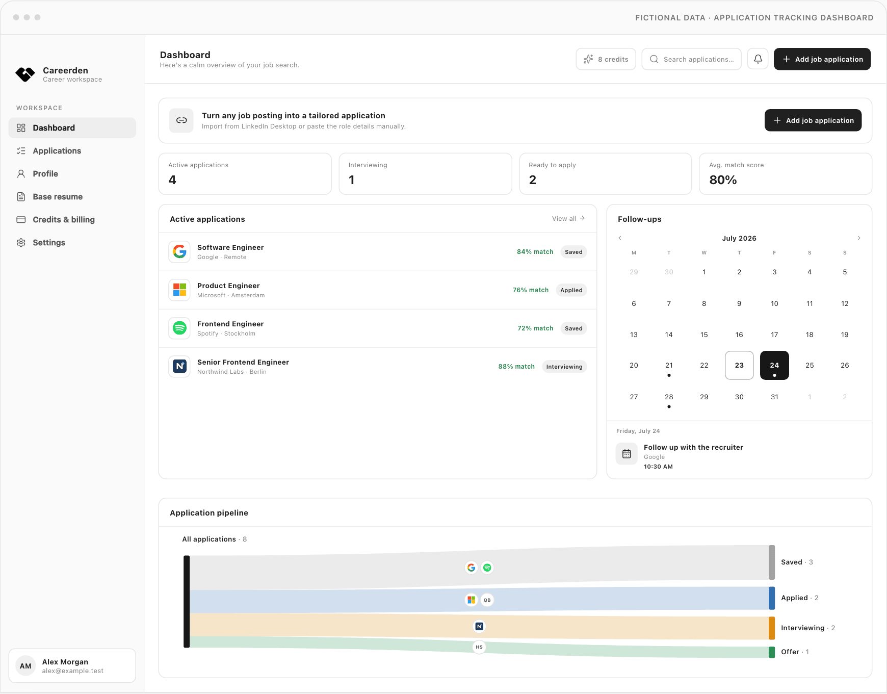

<div align="center">
  
  <h1>Careerden</h1>

<strong>Open-source desktop job application tracker and profile-aware CV and cover-letter creator.</strong>
<br />
Import LinkedIn jobs or paste any posting manually. Match your profile. Create tailored documents.
<br />
Use the Careerden cloud service, or keep everything on your device with Careerden Unplugged.
<br /><br />

  <a href="https://github.com/ErtanOzdemir/careerden/releases/latest">
    
  </a>
  <a href="https://github.com/ErtanOzdemir/careerden/releases">
    
  </a>
  <a href="./LICENSE">
    
  </a>
  <a href="https://github.com/ErtanOzdemir/careerden/actions/workflows/ci.yml">
    
  </a>

<br /><br />

<a href="https://careerden.app/download"><strong>Download</strong></a>
·
<a href="https://careerden.app"><strong>Website</strong></a>
·
<a href="https://github.com/ErtanOzdemir/careerden/releases"><strong>Releases</strong></a>

</div>



## Editions

Careerden ships as two desktop apps built from the same code and released together.

|                      | **Careerden**                                                     | **Careerden Unplugged**                                                    |
| -------------------- | ----------------------------------------------------------------- | -------------------------------------------------------------------------- |
| Where data lives     | Careerden's servers (PostgreSQL and object storage)               | Only on your device                                                        |
| Account              | Email and password with email OTP                                 | None                                                                       |
| AI                   | Included, metered by monthly credits and subscriptions            | Your own OpenAI, Anthropic, Gemini, DeepSeek, or OpenRouter key; unmetered |
| Billing              | Free monthly credits and a Creem subscription                     | None                                                                       |
| Reminders            | In-app, desktop, and optional email                               | In-app and desktop                                                         |
| Works across devices | Yes, through your account                                         | No; one device, one profile                                                |
| Network traffic      | The Careerden API, LinkedIn guest pages, and GitHub update checks | LinkedIn guest pages, your AI provider, and GitHub update checks only      |

"Unplugged" means unplugged from Careerden's servers, not from the internet. Both editions
share the same features otherwise: the tracker, the profile, LinkedIn import, AI match
analysis, document editing and PDF generation, and follow-up reminders. They install side
by side under separate identities (`com.careerden.desktop` and `com.careerden.unplugged`)
with separate data, keychain entries, and update channels.

## Features

- Add applications by pasting company and job details manually, with an optional company logo,
  website, location, and source URL, or import a LinkedIn job through the desktop app.
- Manage application stages, interest level, tags, salary range and type, work style,
  contacts, timeline events, multiple follow-ups, and a reversible archive for inactive roles.
- Filter, sort, search, and paginate the application log, with dashboard analytics and
  real-time updates over server-sent events.
- Maintain a reusable profile with experience, education, projects, certifications,
  links, and analysis/reminder preferences.
- Analyze each role against the profile with OpenAI, Gemini, DeepSeek, Anthropic, or
  OpenRouter and review matched, partial, and missing requirements.
- Edit AI-assisted CV and cover-letter content before generating files, with a live
  on-screen HTML preview rendered from a predefined template as you edit.
- Generate CV and cover-letter PDFs from the same predefined HTML templates, then
  download them through signed, expiring URLs.
- Receive follow-up reminders in the app and as native operating-system alerts, with
  optional email delivery through local SMTP or production Resend in the cloud edition.
- Cloud edition: sign in with email and password using email OTP verification.
- Unplugged edition: no account; bring your own AI provider key, stored with the operating
  system's keychain and never sent anywhere but the provider.

## Quick Start

### Prerequisites

- Node.js 22 (the version is pinned in `.nvmrc`)
- pnpm 9.15.0
- Docker with Docker Compose
- A Chromium browser installed for Playwright PDF rendering

### Setup

```bash
git clone git@github.com:ErtanOzdemir/careerden.git
cd careerden

nvm use
corepack enable
pnpm install
pnpm exec playwright install chromium

cp .env.example .env
docker compose up -d
```

Before starting the app, edit `.env`:

1. Set `OPEN_OBSERVE_KEY` to a non-empty OpenObserve Basic Auth credential. The API
   validates this value during startup; the local OpenObserve UI is available at
   <http://localhost:5080> after Docker Compose starts.
2. Set the API key for the selected `AI_PROVIDER` if you want to run match analysis and
   produce AI-assisted document guidance. The tracker can still be used without running
   AI jobs.
3. Replace the development auth secret before using the app outside local development.

Start the complete cloud desktop development stack:

```bash
pnpm dev:desktop
```

The command starts the API, React/Vite web app, LLM worker, documents worker,
notifications worker, and Electron desktop app through Turbo. Electron waits until the API health
check and the Vite dev server respond before opening its window. On first use, create an account and open MailHog at
<http://localhost:8025> to read the verification OTP. The desktop app can then process submitted
LinkedIn URLs through public guest endpoints without connecting a LinkedIn account.

The example environment also enables follow-up reminder email delivery, so those messages appear in
the same MailHog inbox. Keep `NOTIFICATION_EMAIL_ENABLED=false` in environments where reminder
emails should not be dispatched.

### Careerden Unplugged in Development

The Unplugged edition needs no Docker services, no `.env` changes, and no account:

```bash
pnpm dev:desktop:local
```

The command starts the Vite web app and Electron with the local edition enabled. Electron
starts the embedded backend on loopback port `3010` with a per-run token that the Vite proxy
forwards. Data lives in the `Careerden Unplugged` folder under the operating system's
application data directory. To skip typing a profile, fill it with a fictional sample while
the app is closed:

```bash
pnpm seed:local-profile
```

Add an AI provider key on the **AI provider** page to run match analysis. OpenRouter accepts
any model id, but choose one that supports structured outputs; some free models only work in
approved apps.

### Local Services

| Service        | Address                        | Purpose                              |
| -------------- | ------------------------------ | ------------------------------------ |
| Web app        | <http://localhost:5173>        | Vite development server              |
| API            | <http://localhost:3000>        | Express API                          |
| API health     | <http://localhost:3000/health> | Runtime health check                 |
| PostgreSQL     | `localhost:5432`               | Application and authentication state |
| Redis          | `localhost:6380`               | BullMQ and real-time change delivery |
| MailHog        | <http://localhost:8025>        | Development email inbox              |
| RustFS API     | <http://localhost:9000>        | S3-compatible object storage         |
| RustFS console | <http://localhost:9001>        | Object-storage administration        |
| OpenObserve    | <http://localhost:5080>        | OpenTelemetry trace collection       |

The Vite proxy also exposes the health check at <http://localhost:5173/api/health>.

## How It Works

```text
LinkedIn URL or manual entry
           |
           v
Authenticated API -> PostgreSQL + transactional outbox
           |
           +-> Electron claims scrape work -> guest HTTP fetch -> raw + normalized scrape data
           |
           +-> reserve credit -> BullMQ -> LLM worker -> validated match analysis
           |
           +-> BullMQ -> documents worker -> HTML template/PDF rendering -> S3-compatible storage
           |
           +-> follow-up schedule -> notifications worker -> in-app/optional email reminder
                                                        |
                                                        +-> Redis -> API SSE -> Electron native alert
```

LinkedIn scraping runs locally in an Electron utility process through public guest HTTP
responses and HTML parsing; it does not require a LinkedIn account. The desktop worker
claims queued work from the API, renews the claim while scraping, and submits both
normalized and raw results. The API persists workflow changes and outbox events transactionally.
The LLM, documents, and notifications workers consume BullMQ jobs independently from
the API.

Each authenticated account receives 10 free AI credits for the current UTC calendar
month. The grant is created idempotently after registration or on the next authenticated
credit access, expires at the start of the next UTC month, and is never duplicated within
the same month. `GET /billing/credits` returns the authenticated user's available and
reserved totals.

One logical match-analysis attempt reserves one credit in the same PostgreSQL transaction
that records the attempt and analysis outbox event. BullMQ retries retain that reservation.
The LLM worker consumes it only after validated analysis output is persisted; terminal
failure, deletion, supersession, or a 24-hour timeout releases it without a usage entry.

Creem provides hosted subscription checkout and customer billing management. Each
confirmed paid period creates one idempotent 100-credit grant that expires at the
provider-confirmed period end. The current recurring product is $10 USD per month before
applicable taxes. Scheduled and completed cancellations update subscription state without
revoking credits from an already-paid period.

The authenticated web shell shows available and reserved credits in the top bar. Settings
explains credit settlement, displays subscription state, and opens Creem checkout or the
customer portal. Credit state refreshes on focus and application changes, and temporarily
polls while work has an active reservation so worker settlement becomes visible without a
page reload. A coded `payment_required` response links the preserved scraped job back to
credit settings.

In development, Electron loads the Vite renderer and connects to the standalone API. A
packaged app instead serves the bundled renderer from `careerden://app` and proxies
same-origin `/api` requests to its build-time API URL, or to its embedded backend in
Careerden Unplugged. See the
[desktop runtime and release guide](apps/desktop/README.md) for notification behavior,
automatic-update behavior, packaging, signing, checksums, and the manual release
checklist.

### Careerden Unplugged

The Unplugged edition runs the same API and use cases inside the app instead of on
Careerden's servers:

```text
React renderer at careerden://app
           |
           | /api/* through the custom-protocol proxy, which adds a per-launch token
           v
Local backend utility process on 127.0.0.1:<random port>
  same Express routes and use cases, without auth, billing, or support routes
  PGlite (embedded PostgreSQL) + files on disk
  in-process outbox runner -> match analysis, document generation, storage cleanup
  in-process reminder timers, restored from the database on every start
           |
           +-> Electron main process: PDF printing and the decrypted AI key, on request
           +-> AI provider chosen by the user, called directly from the device
```

There are no credits: every analysis runs on the user's own key. Analysis is not queued
while no provider key is configured, and the job shows an **Add API key** prompt instead.
Reminders that fell due while the app was closed are delivered on the next start when the
follow-up is at most seven days old.

Job processing uses explicit states:

```text
queued -> scraping -> scraped -> analyzing -> review_ready -> generating_documents -> completed
```

Manual tracker entries can move directly into the stored scraped state without browser
scraping. Analysis can run automatically per profile preference or be requested from the
application detail page. Eligible processing states can transition to `failed`; the
failure reason and workflow event are preserved so retries remain explicit.

## Architecture

Careerden is a strict ESM TypeScript monorepo organized around clean architecture and
bounded contexts.

```text
careerden/
├── apps/
│   ├── api/                   Express transport, auth, SSE, and composition root
│   ├── desktop/               Electron renderer, native notifications, and local scraping
│   ├── documents-worker/      BullMQ application-pack rendering consumer
│   ├── llm-worker/            BullMQ match-analysis consumer
│   ├── notifications-worker/  BullMQ reminder consumer and outbox recovery
│   └── web/                   React application served by Vite
└── packages/
    ├── application/           Use cases, ownership checks, and workflow orchestration
    ├── config/                Shared environment loading and validation
    ├── contracts/             Shared DTOs and Zod schemas
    ├── domain/                Entities, policies, and provider/repository interfaces
    └── infrastructure/        PostgreSQL, Redis, AI, scraping, rendering, and storage adapters
```

Backend code uses the same bounded-context names across layers, primarily `profiles`,
`job-applications`, `scraping`, `matching`, `documents`, and `notifications`, with
supporting `persistence`, `queue`, and `storage` capabilities.

Dependencies point inward: apps compose packages, application code depends on domain
and contracts, and infrastructure implements domain interfaces. HTTP routes remain thin;
ownership checks and business workflows live in application use cases.

### Two Editions, One Codebase

The editions differ only in the adapters their composition roots choose. `createApiApp`
(`apps/api/src/api-app.ts`) wires every route and use case from injected adapters, and the
use cases that the workers run live in `packages/application`. Two composition roots then pick
the infrastructure:

| Concern        | Cloud: `createApiRuntime` and workers | Unplugged: `createLocalApiRuntime`               |
| -------------- | ------------------------------------- | ------------------------------------------------ |
| Database       | PostgreSQL                            | PGlite in the app's data folder                  |
| Files          | S3-compatible storage                 | Local disk with HMAC-signed, expiring links      |
| Background     | Outbox → BullMQ → worker processes    | In-process outbox runner                         |
| Realtime       | Redis pub/sub                         | In-memory change buses                           |
| Authentication | Better Auth sessions                  | Per-launch token on loopback, one local user     |
| Credits        | PostgreSQL credit ledger              | Same ledger behind an unmetered decorator        |
| AI             | Server key from the environment       | User key resolved on every call                  |
| PDF            | Playwright Chromium                   | Electron `printToPDF` without scripts or network |

A build-time `CAREERDEN_EDITION` (`cloud` or `local`) selects the desktop runtime, and
`VITE_CAREERDEN_EDITION` removes sign-in, billing, credits, and support from the Unplugged
renderer. New routes and use cases belong in the shared composition, so both editions get them.

### Architecture Decisions

- **One codebase instead of a fork.** Every feature, fix, and migration reaches both editions
  at once. The cost is a few edition checks in the composition roots, the desktop shell, and
  the renderer.
- **PGlite instead of SQLite.** PGlite is PostgreSQL compiled to WebAssembly, so the same Knex
  migrations, `jsonb` queries, and repositories run unchanged in both editions. SQLite would
  have meant a second SQL dialect for every query. The trade-off is about 38 MB of fixed
  PostgreSQL files in each local data folder.
- **An in-process outbox runner instead of an in-memory queue.** An outbox event is marked
  processed only after its handler finishes, so analysis or document generation interrupted by
  closing the app is retried on the next start. Retries, backoff, and dead-lettering match the
  BullMQ workers.
- **A utility process behind a loopback token.** The backend runs outside Electron's main
  process so database and AI work never block the window. It listens only on `127.0.0.1`, and
  only requests carrying the token that Electron generates for each launch are accepted.
- **Keys in the operating system's keychain.** AI keys are encrypted with Electron
  `safeStorage` and decrypted only in the main process, which hands the active key to the backend
  for each AI call; the renderer can save, test, switch, and remove keys but never read one
  back. Keys are never stored in plain
  files.
- **No Chromium cookie store in Unplugged.** The local edition reaches its backend with
  Node's `fetch`, because opening the encrypted cookie store would trigger a keychain prompt on
  every launch and the edition has no cookies to keep.
- **One version for both editions.** A single `vX.Y.Z` tag builds both editions into one draft
  release. Distinct artifact names and updater channels (`latest*.yml` and `local*.yml`) keep
  each installation on its own edition.

### Tech Stack

| Area                | Technology                                                               |
| ------------------- | ------------------------------------------------------------------------ |
| Runtime             | Node.js 22                                                               |
| Language            | TypeScript 5.7, strict ESM, NodeNext resolution                          |
| Package management  | pnpm 9.15 and Turborepo 2.9                                              |
| Desktop             | Electron 43                                                              |
| Web                 | React 19, React Router 7, Vite 6, Tailwind CSS 4                         |
| Rich-text editing   | Tiptap 3                                                                 |
| API and validation  | Express 4 and Zod 3                                                      |
| Authentication      | Better Auth with email OTP verification                                  |
| Database            | PostgreSQL 16 via Knex 3 and `pg`; PGlite in Unplugged                   |
| Queues and realtime | Redis 7 and BullMQ 5; in-process in Unplugged                            |
| AI                  | Vercel AI SDK 6 with OpenAI, Gemini, DeepSeek, Anthropic, and OpenRouter |
| Scraping            | Public guest HTTP responses and HTML parsing                             |
| PDF                 | Playwright 1.60; Electron `printToPDF` in Unplugged                      |
| Documents           | Predefined HTML templates                                                |
| Storage             | AWS S3 SDK with RustFS locally and Cloudflare R2                         |
| Observability       | OpenTelemetry and OpenObserve                                            |
| Testing             | Vitest 2 and Testing Library                                             |
| Quality             | ESLint 10 and Prettier 3                                                 |

## Environment Variables

Copy `.env.example` to `.env`. Runtime schemas provide the defaults shown below unless
the variable is marked required.

### API, Auth, and Frontend

| Variable                    | Description                                                  | Default                  |
| --------------------------- | ------------------------------------------------------------ | ------------------------ |
| `NODE_ENV`                  | `development`, `test`, or `production`                       | `development`            |
| `PORT`                      | API port                                                     | `3000`                   |
| `DATABASE_URL`              | PostgreSQL connection string                                 | Required                 |
| `REDIS_URL`                 | Redis connection string                                      | `redis://localhost:6380` |
| `BETTER_AUTH_SECRET`        | Better Auth signing secret; 32+ bytes required in production | Development-only value   |
| `BETTER_AUTH_URL`           | Public API/auth base URL                                     | `http://localhost:3000`  |
| `WEB_ORIGIN`                | Allowed credentialed web origin                              | `http://localhost:5173`  |
| `VITE_API_BASE_URL`         | API URL used by the web and development desktop renderer     | `http://localhost:3000`  |
| `DESKTOP_API_BASE_URL`      | API URL embedded in a production desktop build               | `http://localhost:3000`  |
| `DESKTOP_UPDATE_REPOSITORY` | Public `owner/repository` used for desktop updates           | Unset                    |

### Creem Billing

| Variable               | Description                                                  | Default |
| ---------------------- | ------------------------------------------------------------ | ------- |
| `CREEM_API_KEY`        | Creem API key                                                | Unset   |
| `CREEM_WEBHOOK_SECRET` | Secret used to verify the raw `creem-signature` webhook HMAC | Unset   |
| `CREEM_PRODUCT_ID`     | Creem subscription product used for hosted checkout          | Unset   |
| `CREEM_PLAN_KEY`       | Internal plan identifier stored with subscriptions           | `pro`   |
| `CREEM_SUCCESS_URL`    | Browser destination after successful hosted checkout         | Unset   |
| `CREEM_TEST_MODE`      | Use Creem's test API                                         | `true`  |

Development and test environments may omit all three Creem credentials to disable
checkout, portal, and webhook routes. Partial Creem configuration is rejected. Production
requires `CREEM_API_KEY`, `CREEM_WEBHOOK_SECRET`, and `CREEM_PRODUCT_ID`, and requires
`CREEM_TEST_MODE=false`.

### Queue Operations Dashboard

| Variable                   | Description                            | Default |
| -------------------------- | -------------------------------------- | ------- |
| `BULLSTUDIO_PORT`          | Host port for the Bullstudio dashboard | `4000`  |
| `BULLSTUDIO_POLL_INTERVAL` | Redis polling interval in milliseconds | `5000`  |

### AI and Workers

| Variable                           | Description                                                  | Default  |
| ---------------------------------- | ------------------------------------------------------------ | -------- |
| `AI_PROVIDER`                      | `openai`, `gemini`, `deepseek`, `anthropic`, or `openrouter` | `openai` |
| `OPENAI_API_KEY`                   | OpenAI API key                                               | —        |
| `GEMINI_API_KEY`                   | Google Gemini API key                                        | —        |
| `DEEPSEEK_API_KEY`                 | DeepSeek API key                                             | —        |
| `ANTHROPIC_API_KEY`                | Anthropic API key                                            | —        |
| `OPENROUTER_API_KEY`               | OpenRouter API key                                           | —        |
| `LLM_WORKER_CONCURRENCY`           | Parallel match-analysis jobs                                 | `5`      |
| `LLM_WORKER_HEALTH_PORT`           | Private LLM worker health port                               | `3101`   |
| `DOCUMENTS_WORKER_CONCURRENCY`     | Parallel application-pack jobs                               | `1`      |
| `DOCUMENTS_WORKER_HEALTH_PORT`     | Private documents health port                                | `3102`   |
| `NOTIFICATIONS_WORKER_CONCURRENCY` | Parallel follow-up reminder jobs                             | `1`      |
| `NOTIFICATIONS_WORKER_HEALTH_PORT` | Private notifications health port                            | `3103`   |
| `NOTIFICATION_EMAIL_ENABLED`       | Send reminder emails through the active provider             | `false`  |

### Email, Storage, Scraping, and Tracing

| Variable                           | Description                             | Default                                |
| ---------------------------------- | --------------------------------------- | -------------------------------------- |
| `SMTP_HOST`                        | Development/test SMTP server host       | `localhost`                            |
| `SMTP_PORT`                        | Development/test SMTP server port       | `1025`                                 |
| `EMAIL_FROM`                       | Sender used for OTP and reminder emails | `Careerden <no-reply@careerden.local>` |
| `RESEND_API_KEY`                   | Production Resend API credential        | —                                      |
| `OBJECT_STORAGE_ENDPOINT`          | S3-compatible storage endpoint          | Development-only local endpoint        |
| `OBJECT_STORAGE_BUCKET`            | Generated file/template bucket          | `careerden`                            |
| `OBJECT_STORAGE_ACCESS_KEY_ID`     | S3-compatible access key                | Development-only `rustfsadmin`         |
| `OBJECT_STORAGE_SECRET_ACCESS_KEY` | S3-compatible secret key                | Development-only `rustfsadmin`         |
| `OBJECT_STORAGE_REGION`            | S3-compatible region                    | `us-east-1`                            |
| `OBJECT_STORAGE_FORCE_PATH_STYLE`  | Use S3 path-style addressing            | `true`                                 |
| `OPEN_OBSERVE_URL`                 | OpenTelemetry HTTP trace endpoint       | `http://localhost:5080`                |
| `OPEN_OBSERVE_KEY`                 | OpenObserve Basic Auth credential       | Required                               |

Development and test runtimes deliver through SMTP, so the defaults route authentication and
enabled reminder emails to MailHog. Production selects the Resend HTTP API automatically. The API
requires `RESEND_API_KEY` and a valid, non-local `EMAIL_FROM`; the notifications worker requires
the same values when `NOTIFICATION_EMAIL_ENABLED=true`. `SMTP_FROM` is no longer accepted—rename it
to `EMAIL_FROM` in existing environments.

Before deploying, add and verify the `EMAIL_FROM` domain or subdomain in Resend, publish the SPF and
DKIM records it supplies, and create an API key. The sender domain must exactly match the verified
domain. Set `RESEND_API_KEY` and `EMAIL_FROM` on the API and, when reminder email is enabled, the
notifications worker. Follow-up outbox retries reuse their persisted message ID as Resend's
idempotency key. Reminder email delivery stops after 20 failed attempts or when its 23-hour retry
window expires, before Resend's 24-hour idempotency window expires; permanent provider rejections
and exhausted or stale events are dead-lettered instead of being sent indefinitely. The
notifications worker logs retry and dead-letter transitions using event identifiers without email
content.

The API, documents worker, and notifications worker must use the same object-storage
configuration. Existing `RUSTFS_*` names remain accepted for compatibility, but new
deployments should use `OBJECT_STORAGE_*`.

With `NODE_ENV=production`, the API refuses to start with a missing, known-development,
or shorter-than-32-byte `BETTER_AUTH_SECRET`. The API, documents worker, and notifications
worker also reject local object-storage endpoints, known development access keys, and
missing, known-development, or shorter-than-32-byte object-storage secrets. Generate
independent random secrets instead of copying the examples:

```bash
openssl rand -base64 32
```

Rotate deployed auth and storage credentials if a development/default value was ever
used. Changing `BETTER_AUTH_SECRET` invalidates existing authenticated sessions, so plan
for users to sign in again.

### Cloudflare R2 in production

Create a private R2 bucket and an API token with Object Read & Write access scoped to that
bucket. Set these values on the API, documents worker, and notifications worker:

```bash
OBJECT_STORAGE_ENDPOINT=https://<ACCOUNT_ID>.r2.cloudflarestorage.com
OBJECT_STORAGE_BUCKET=careerden-production
OBJECT_STORAGE_ACCESS_KEY_ID=<R2_ACCESS_KEY_ID>
OBJECT_STORAGE_SECRET_ACCESS_KEY=<R2_SECRET_ACCESS_KEY>
OBJECT_STORAGE_REGION=auto
OBJECT_STORAGE_FORCE_PATH_STYLE=false
```

Create the bucket before starting Careerden. Keep the bucket private; Careerden generates
15-minute presigned download URLs. Use the R2 S3 API endpoint shown above rather than a
custom domain, because R2 presigned URLs are supported only on the S3 API domain.

### Production containers on Coolify

The API and each BullMQ worker have a dedicated production Dockerfile. Build every image
from the repository root so Turborepo can prune the correct workspace dependency graph:

```bash
docker build -f apps/api/Dockerfile -t careerden-api .
docker build -f apps/llm-worker/Dockerfile -t careerden-llm-worker .
docker build -f apps/documents-worker/Dockerfile -t careerden-documents-worker .
docker build -f apps/notifications-worker/Dockerfile -t careerden-notifications-worker .
```

The API and documents-worker images install Playwright's matching Chromium headless shell
and render a smoke-test PDF during the image build. This keeps the browser in
`/ms-playwright` instead of relying on an ephemeral home-directory cache. The LLM and
notifications images do not download browser binaries.

Configure four separate Coolify applications with the Dockerfile build pack and `/` as
the Base Directory:

| Coolify application  | Dockerfile location                     | Network exposure         |
| -------------------- | --------------------------------------- | ------------------------ |
| API                  | `/apps/api/Dockerfile`                  | Port `3000`, `/health`   |
| LLM worker           | `/apps/llm-worker/Dockerfile`           | No public port or domain |
| Documents worker     | `/apps/documents-worker/Dockerfile`     | No public port or domain |
| Notifications worker | `/apps/notifications-worker/Dockerfile` | No public port or domain |

Each worker image has an internal Docker health check against its loopback-only
`/health/ready` endpoint. Readiness requires an active, unpaused BullMQ worker plus
successful Redis and PostgreSQL checks. The endpoints and health ports are operational
inside the container only; do not assign public Coolify domains to worker applications.

Assign the Redis Database Resource and all four applications to the same Coolify Server
and Destination. Copy Redis's **Internal URL** into an environment-level shared variable,
for example `CAREERDEN_REDIS_URL`, and set this on every application:

```text
REDIS_URL={{environment.CAREERDEN_REDIS_URL}}
```

Keep Redis private. Do not use `localhost`, `127.0.0.1`, or the development default
`redis://localhost:6380` from a production container: those addresses refer to the
container itself. If the Redis credential contains `$` or another value Coolify may
interpolate, mark the shared variable as literal. Let Coolify manage the Destination
network rather than adding custom Docker networks.

## API Overview

The API listens on port 3000 by default. The Vite development server proxies `/api/*`
to the same routes after removing the `/api` prefix. Apart from `/health`, Better Auth
handlers, and the signature-protected Creem webhook, endpoints require an authenticated
session cookie and enforce profile ownership.
Unexpected failures return the stable `internal` code, the message `Internal server error`,
and a trace ID that can be used to correlate the response with redacted server logs.
API responses also enforce a non-rendering CSP, clickjacking/content-sniffing defenses,
a restrictive permissions policy, and production HSTS.

The Vite web build emits a CSP meta policy and a `dist/_headers` deployment file with
the full browser security-header set. Static hosting must apply that file (or configure
equivalent response headers at the edge); the meta policy alone cannot enforce HSTS,
permissions policy, or frame restrictions. The marketing service and packaged Electron
renderer enforce their separately tailored policies in their own runtimes.

### Health and Authentication

| Method | Path      | Description                                             |
| ------ | --------- | ------------------------------------------------------- |
| `GET`  | `/health` | API health check                                        |
| `*`    | `/auth/*` | Better Auth sign-up, sign-in, OTP, and session handlers |

### Billing

| Method | Path                      | Description                                                |
| ------ | ------------------------- | ---------------------------------------------------------- |
| `GET`  | `/billing/credits`        | Read the authenticated user's authoritative credit balance |
| `GET`  | `/billing/subscription`   | Read the authenticated user's current subscription state   |
| `POST` | `/billing/checkout`       | Create a Creem hosted-checkout link                        |
| `POST` | `/billing/portal`         | Create a Creem customer-portal link                        |
| `POST` | `/billing/webhooks/creem` | Receive raw, HMAC-verified subscription lifecycle events   |

Starting an explicit match analysis without an available credit returns HTTP `402` with
the code `payment_required`, plus `requiredCredits` and `availableCredits`. Automatic
analysis at zero credits preserves the scraped job and records an `insufficient_credits`
workflow reason instead of queueing AI work.

Configure the Creem dashboard webhook destination as
`https://<api-host>/billing/webhooks/creem` and use the matching signing secret for
`CREEM_WEBHOOK_SECRET`. Paid events grant credits exactly once. Scheduled cancellation,
final cancellation, past-due, expired, and subscription-update events synchronize the
provider-neutral subscription state; a cancellation does not expire an already-paid
credit lot before its recorded period end.

Bullstudio runs as a separate, opt-in Docker service and discovers Careerden's BullMQ queues
from Redis. Start it with:

```bash
docker compose --profile operations up -d bullstudio
```

Open <http://localhost:4000> and sign in with the hardcoded username `bullstudio` and
password `Careerden-Bullstudio-2026!`. The port binds to `127.0.0.1` by default; production
access should go through an authenticated HTTPS reverse proxy or private network.
Standalone Bullstudio can retry/remove jobs and pause/resume queues, so treat access as
privileged operations access rather than read-only monitoring. Because the credentials are
stored in `compose.yaml`, anyone with repository access can read them.

### Profiles

| Method         | Path            | Description                        |
| -------------- | --------------- | ---------------------------------- |
| `GET`, `PATCH` | `/profiles/me`  | Read or update the current profile |
| `POST`         | `/profiles`     | Create a profile                   |
| `GET`, `PATCH` | `/profiles/:id` | Read or update an owned profile    |

CV and cover-letter documents are always rendered from the predefined HTML templates in
`@careerden/contracts` (`html-template-registry.ts`); there is no upload step. A profile can
set `defaultCvTemplateId`/`defaultCoverLetterTemplateId` through `PATCH /profiles/:id`, and a
job application can override either per application via `applicationPackPreferences`.

### Job Applications

| Method                   | Path                                                   | Description                                        |
| ------------------------ | ------------------------------------------------------ | -------------------------------------------------- |
| `POST`, `GET`            | `/job-applications`                                    | Create or list applications                        |
| `POST`                   | `/job-applications/manual`                             | Create from pasted manual job details              |
| `GET`                    | `/job-applications/analytics`                          | Read profile-scoped dashboard stats                |
| `GET`                    | `/job-applications/stream`                             | Stream profile-scoped changes (SSE)                |
| `POST`                   | `/job-applications/from-scrape`                        | Create from an existing scrape                     |
| `GET`, `PATCH`, `DELETE` | `/job-applications/:id`                                | Read, update, or permanently delete an application |
| `PUT`, `DELETE`          | `/job-applications/:id/archive`                        | Archive or restore an application                  |
| `PUT`                    | `/job-applications/:id/status`                         | Advance processing status                          |
| `POST`                   | `/job-applications/:id/retry`                          | Retry failed processing                            |
| `POST`                   | `/job-applications/:id/analysis`                       | Queue match analysis                               |
| `POST`                   | `/job-applications/:id/application-pack/generations`   | Queue CV and cover-letter generation               |
| `GET`, `POST`            | `/job-applications/:id/events`                         | List or add timeline events                        |
| `GET`, `POST`            | `/job-applications/:id/contacts`                       | List or add contacts                               |
| `PATCH`, `DELETE`        | `/job-applications/:id/contacts/:contactId`            | Update or delete a contact                         |
| `GET`, `POST`            | `/job-applications/:id/follow-ups`                     | List or schedule follow-ups                        |
| `PATCH`, `DELETE`        | `/job-applications/:id/follow-ups/:followUpId`         | Update or delete a follow-up                       |
| `PUT`                    | `/job-applications/:id/document-content`               | Save editable document content                     |
| `POST`                   | `/job-applications/:id/documents/generate`             | Generate CV and cover-letter files                 |
| `GET`                    | `/job-applications/:id/documents/:documentId/download` | Create a signed download URL                       |
| `POST`                   | `/job-applications/:id/document-preview`               | Render on-screen HTML preview from draft content   |

Listing requires `profileId`. Supported filters include processing/application status,
archive state, company, role, role type, priority, tag, date range, and free-text search.
`archiveState` defaults to `active` and accepts `archived` for the dedicated archive view.
Pagination uses `page` and `pageSize` (default 20, maximum 100), with `sortBy` and
`sortDirection` for ordering; archived results may be sorted by `archivedAt`.

Archiving preserves the application's tracker stage, processing results, documents, contacts,
events, and follow-ups. Only stable applications can be archived. Archived applications are
read-only, excluded from dashboard metrics, global search, scraping, and reminder delivery, and
must be restored before processing or editing. Active and archived applications can both be
permanently deleted; restoring reschedules unsent follow-ups that are still in the future.

Manual creation uses `multipart/form-data`. It requires `profileId`, `companyName`, `roleTitle`,
and `jobDescription`; it optionally accepts `companyDescription`, `companyWebsiteUrl`,
`jobLocation`, `jobUrl`, JSON-encoded `applicationPackPreferences`, and a `companyLogo` PNG, JPEG,
or WebP file up to 5 MB. Manual applications transition directly to `scraped` and follow the
profile's automatic match-analysis preference.

The desktop scraping worker additionally uses these authenticated endpoints:

| Method | Path                                       | Purpose                    |
| ------ | ------------------------------------------ | -------------------------- |
| `POST` | `/job-applications/scraping/claim`         | Claim the next scrape job  |
| `PUT`  | `/job-applications/:id/scrape-data`        | Submit raw/normalized data |
| `POST` | `/job-applications/:id/scraping/heartbeat` | Renew a scrape claim       |
| `POST` | `/job-applications/:id/scraping/fail`      | Report a scrape failure    |
| `POST` | `/job-applications/:id/scraping/retry`     | Retry scraping             |

### Notifications

| Method  | Path                          | Description                       |
| ------- | ----------------------------- | --------------------------------- |
| `GET`   | `/notifications`              | List current-user notifications   |
| `GET`   | `/notifications/unread-count` | Count unread notifications        |
| `GET`   | `/notifications/stream`       | Stream notification changes (SSE) |
| `PATCH` | `/notifications/:id/read`     | Mark one notification read        |
| `PATCH` | `/notifications/read-all`     | Mark all notifications read       |

## Development

### Common Commands

| Command                                                        | Purpose                                                  |
| -------------------------------------------------------------- | -------------------------------------------------------- |
| `pnpm dev`                                                     | Start Docker services, then every app through Turbo      |
| `pnpm dev:desktop`                                             | Start API, web, workers, then Electron once they respond |
| `pnpm dev:desktop:local`                                       | Start the web app and Careerden Unplugged without Docker |
| `pnpm seed:local-profile`                                      | Fill the Unplugged profile with a fictional sample       |
| `pnpm dev:services`                                            | Start PostgreSQL, Redis, and RustFS and wait for them    |
| `pnpm dev:api`                                                 | Start only the API                                       |
| `pnpm dev:llm-worker`                                          | Start only the LLM worker                                |
| `pnpm dev:documents-worker`                                    | Start only the documents worker                          |
| `pnpm dev:notifications-worker`                                | Start only the notifications worker                      |
| `pnpm --filter @careerden/web dev`                             | Start only the Vite web app                              |
| `pnpm --filter @careerden/desktop build`                       | Build the Electron main process and renderer             |
| `pnpm --filter @careerden/desktop package`                     | Package desktop for the current host platform            |
| `pnpm --filter @careerden/desktop package:local`               | Package Careerden Unplugged after a local edition build  |
| `pnpm --filter @careerden/infrastructure smoke:playwright-pdf` | Verify local Playwright PDF rendering                    |
| `pnpm build`                                                   | Build every workspace                                    |
| `pnpm test`                                                    | Run all Vitest suites                                    |
| `pnpm lint`                                                    | Run ESLint                                               |
| `pnpm format:check`                                            | Check Prettier formatting                                |
| `pnpm typecheck`                                               | Type-check every workspace                               |
| `pnpm lint:fix` / `pnpm format`                                | Apply mechanical lint/format fixes                       |

Backend development commands run `tsx watch` with Node's `development` export condition. Internal
`@careerden/*` packages therefore resolve directly to their TypeScript sources and trigger an app
restart when a dependency changes. `NODE_ENV` still controls runtime behavior independently; even
a local production-mode check keeps source hot reload while it is launched through a `dev` command.

Use `docker compose up -d` instead of `pnpm dev:services` when local OTP email and
OpenObserve are also needed.

Desktop installers for both editions are produced by the tag-triggered GitHub Actions
workflow as one draft release together with platform updater metadata and the
minimum-supported-version policy. Build Careerden Unplugged locally with
`CAREERDEN_EDITION=local VITE_CAREERDEN_EDITION=local pnpm --filter @careerden/desktop build`. Publishing remains a manual verification step and is what makes a release
visible to installed updaters. Follow the complete
[desktop release checklist](apps/desktop/README.md#draft-release-workflow) before tagging
or publishing a version.

### Database Migrations

PostgreSQL migrations run automatically during API startup, and in Careerden Unplugged on
every app start against its embedded PGlite database. Because local migrations run on users'
devices where they cannot be rolled back, keep migrations additive. They can also be managed
from the repository root:

```bash
pnpm migrate:status
pnpm migrate:latest
pnpm migrate:rollback
pnpm migrate:make <migration-name>
```

Additional one-step controls are available as `pnpm migrate:up` and
`pnpm migrate:down`.

### Testing and Quality Gates

```bash
# All tests
pnpm test

# One workspace
pnpm --filter @careerden/domain test

# Required source-change gates
pnpm lint
pnpm format:check
pnpm typecheck
pnpm test
pnpm build
```

Tests are colocated with their behavior as `*.test.ts` or `*.test.tsx`.

## Contributing

See [CONTRIBUTING.md](CONTRIBUTING.md) for the development workflow, code conventions,
and pull request checklist. Security issues should follow [SECURITY.md](SECURITY.md).

## License

Careerden is free and open-source software licensed under the
[GNU Affero General Public License v3.0](LICENSE).
