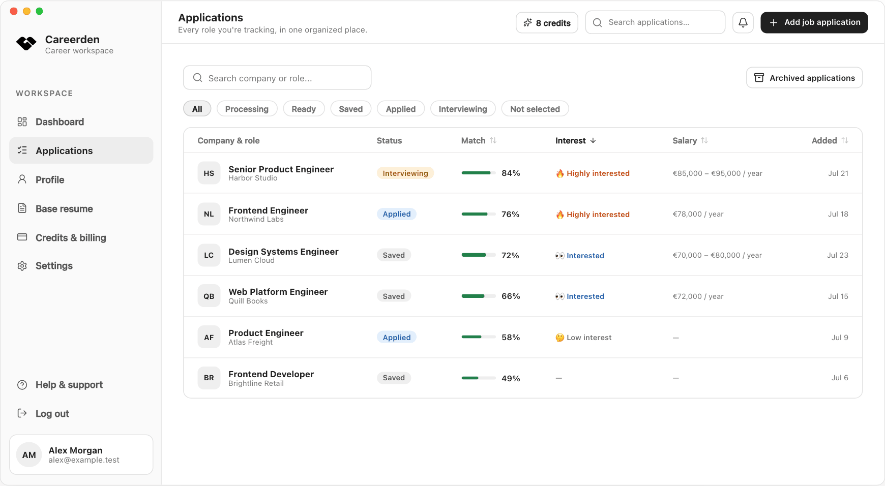
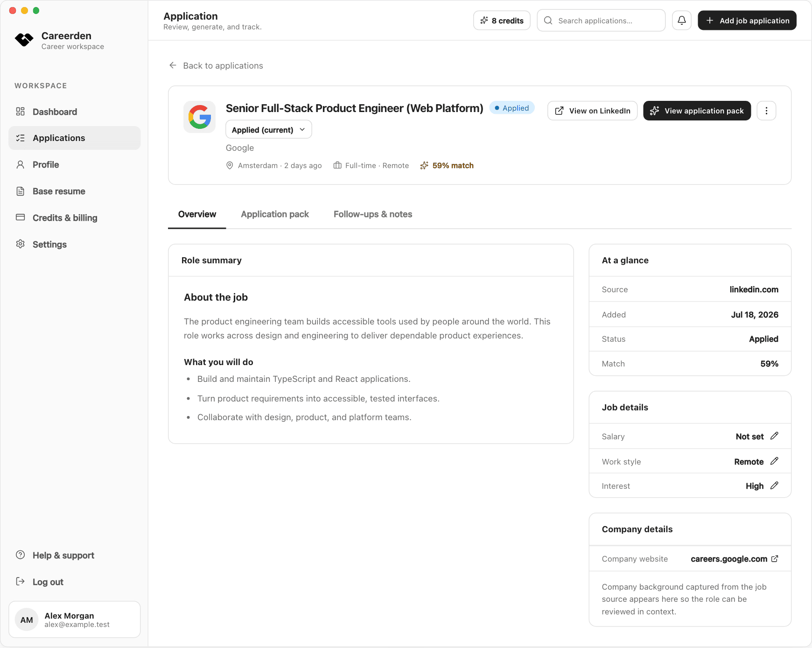
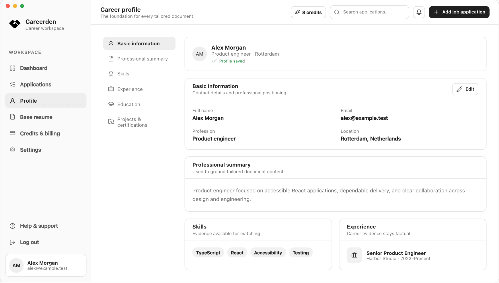
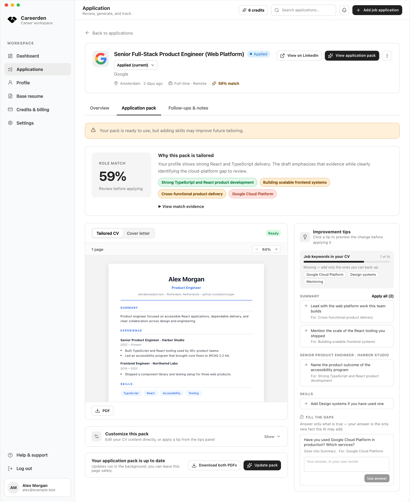

<div align="center">
  
  <h1>Careerden</h1>

<strong>Open-source desktop job application tracker and profile-aware CV and cover-letter creator.</strong>
<br />
Import LinkedIn jobs or paste any posting manually. Match your profile. Create tailored documents.
<br />
Use the Careerden cloud service, or keep everything on your device with Careerden Unplugged.
<br /><br />

  <a href="https://github.com/ErtanOzdemir/careerden/releases/latest">
    
  </a>
  <a href="https://github.com/ErtanOzdemir/careerden/releases">
    
  </a>
  <a href="./LICENSE">
    
  </a>
  <a href="https://github.com/ErtanOzdemir/careerden/actions/workflows/ci.yml">
    
  </a>

<br /><br />

<a href="https://careerden.app/download"><strong>Download</strong></a>
·
<a href="https://careerden.app"><strong>Website</strong></a>
·
<a href="https://github.com/ErtanOzdemir/careerden/releases"><strong>Releases</strong></a>

</div>


The dashboard opens on active applications, the follow-up calendar, and the pipeline across
every stage, with the counts and match scores updating in real time over server-sent events.

|                                                                                                                                                                                                                                                                              |                                                                                                                                                                                                                                                                                 |
| ---------------------------------------------------------------------------------------------------------------------------------------------------------------------------------------------------------------------------------------------------------------------------- | ------------------------------------------------------------------------------------------------------------------------------------------------------------------------------------------------------------------------------------------------------------------------------- |
| <br />**The tracker** — every role you are tracking in one list, with status filters, search, and sorting by match, interest, salary, or date. | <br />**One application** — each role keeps its own status, job and company details, salary, work style, contacts, and follow-ups.                 |
| <br />**Your profile** — one record of experience, education, projects, and skills grounds every document Careerden writes.                             | <br />**The application pack** — the match analysis, a live page preview of the tailored CV and cover letter, and improvement tips, side by side. |

Every screenshot shows the desktop workspace filled with fictional sample data.

## Editions

Careerden ships as two desktop apps built from the same code and released together.

|                      | **Careerden**                                                     | **Careerden Unplugged**                                                    |
| -------------------- | ----------------------------------------------------------------- | -------------------------------------------------------------------------- |
| Where data lives     | Careerden's servers (PostgreSQL and object storage)               | Only on your device                                                        |
| Account              | Email and password with email OTP                                 | None                                                                       |
| AI                   | Included, metered by monthly credits and subscriptions            | Your own OpenAI, Anthropic, Gemini, DeepSeek, or OpenRouter key; unmetered |
| Billing              | Free monthly credits and a Creem subscription                     | None                                                                       |
| Reminders            | In-app, desktop, and optional email                               | In-app and desktop                                                         |
| Works across devices | Yes, through your account                                         | No; one device, one profile                                                |
| Network traffic      | The Careerden API, LinkedIn guest pages, and GitHub update checks | LinkedIn guest pages, your AI provider, and GitHub update checks only      |

"Unplugged" means unplugged from Careerden's servers, not from the internet. Both editions
share the same features otherwise: the tracker, the profile, LinkedIn import, AI match
analysis, document editing and PDF generation, and follow-up reminders. They install side
by side under separate identities (`com.careerden.desktop` and `com.careerden.unplugged`)
with separate data, keychain entries, and update channels.

## Features

- Add applications by pasting company and job details manually, with an optional company logo,
  website, location, and source URL, or import a LinkedIn job through the desktop app.
- Manage application stages, interest level, tags, salary range and type, work style,
  contacts, timeline events, multiple follow-ups, and a reversible archive for inactive roles.
- Filter by status, search by company or role, and sort by match, interest, salary, or date
  added; select a column again to reverse it, once more to return to recently updated first.
- Maintain a reusable profile with experience, education, projects, certifications,
  links, and analysis/reminder preferences.
- Preview that profile as an A4 page in Classic, Editorial, Modern, Minimal, Technical, or
  Ledger, and set one as the default every tailored CV starts from.
- Analyze each role against the profile with OpenAI, Gemini, DeepSeek, Anthropic, or
  OpenRouter and review matched, partial, and missing requirements.
- Edit AI-assisted CV and cover-letter content before generating files, with a live
  on-screen HTML preview rendered from a predefined template as you edit.
- Review each improvement tip as a suggested change before accepting or discarding it, and
  answer gap questions in your own words so the AI adds no fact you did not provide.
- Generate CV and cover-letter PDFs from the same predefined HTML templates, then
  download them through signed, expiring URLs.
- Receive follow-up reminders in the app and as native operating-system alerts, with
  optional email delivery through local SMTP or production Resend in the cloud edition.
- Cloud edition: sign in with email and password using email OTP verification.
- Unplugged edition: no account; bring your own AI provider key, stored with the operating
  system's keychain and never sent anywhere but the provider.

## Quick Start

```bash
git clone git@github.com:ErtanOzdemir/careerden.git
cd careerden

nvm use                                 # Node.js 22, pinned in .nvmrc
corepack enable                         # pnpm 9.15.0
pnpm install
pnpm exec playwright install chromium   # PDF rendering

cp .env.example .env                    # then set OPEN_OBSERVE_KEY and an AI provider key
docker compose up -d                    # PostgreSQL, Redis, RustFS, MailHog, OpenObserve
pnpm dev:desktop                        # API, web, workers, and Electron
```

Careerden Unplugged needs no Docker services, no `.env`, and no account:

```bash
pnpm dev:desktop:local
```

Full prerequisites, per-service commands, local service addresses, and the quality gates
are in the [development guide](docs/development.md).

## How It Works

```text
LinkedIn URL or manual entry
           |
           v
Authenticated API -> PostgreSQL + transactional outbox
           |
           +-> Electron claims scrape work -> guest HTTP fetch -> raw + normalized scrape data
           |
           +-> reserve credit -> BullMQ -> LLM worker -> validated match analysis
           |
           +-> BullMQ -> documents worker -> HTML template/PDF rendering -> S3-compatible storage
           |
           +-> follow-up schedule -> notifications worker -> in-app/optional email reminder
                                                        |
                                                        +-> Redis -> API SSE -> Electron native alert
```

LinkedIn scraping runs locally in an Electron utility process through public guest HTTP
responses and HTML parsing; it does not require a LinkedIn account. The API persists
workflow changes and outbox events transactionally, and the LLM, documents, and
notifications workers consume BullMQ jobs independently from it. Careerden Unplugged runs
the same routes and use cases inside the app instead, against an embedded PostgreSQL
database, with analysis on the user's own AI key.

Each cloud account receives 10 free AI credits per UTC calendar month; a match analysis
reserves one credit in the same transaction that records the attempt, and the worker
consumes it only after validated output is persisted. A Creem subscription adds 100
credits per paid period. Unplugged has no credits.

Jobs move through explicit states:

```text
queued -> scraping -> scraped -> analyzing -> review_ready -> generating_documents -> completed
```

The [architecture guide](docs/architecture.md) covers the full pipeline, the Unplugged
runtime, credit settlement, the monorepo layout, and the decisions behind them.

## Architecture

Careerden is a strict ESM TypeScript monorepo organized around clean architecture and
bounded contexts. `apps/` holds the Express API, the Electron desktop shell, three BullMQ
workers, and the React web app; `packages/` holds the domain, application, contracts,
config, and infrastructure layers. Dependencies point inward: apps compose packages,
application code depends on domain and contracts, and infrastructure implements domain
interfaces.

Both editions are built from the same code and differ only in the adapters their
composition roots choose — PostgreSQL or PGlite, S3-compatible storage or local disk,
BullMQ workers or an in-process outbox runner, Better Auth or a loopback token. See
[docs/architecture.md](docs/architecture.md) for the full picture and the tech stack.

## Documentation

| Guide                                  | Contents                                                          |
| -------------------------------------- | ----------------------------------------------------------------- |
| [Development](docs/development.md)     | Prerequisites, setup, both editions locally, commands, test gates |
| [Architecture](docs/architecture.md)   | Pipeline, Unplugged runtime, monorepo layout, decisions, stack    |
| [Configuration](docs/configuration.md) | Every environment variable and its default                        |
| [API Reference](docs/api.md)           | All HTTP routes, filters, and response conventions                |
| [Deployment](docs/deployment.md)       | Cloudflare R2 and the API/worker containers on Coolify            |
| [Desktop](apps/desktop/README.md)      | Electron runtime, packaging, signing, and the release checklist   |
| [Contributing](CONTRIBUTING.md)        | Workflow, branch and commit conventions, PR checklist             |
| [Security](SECURITY.md)                | Supported versions and how to report a vulnerability              |

## Contributing

See [CONTRIBUTING.md](CONTRIBUTING.md) for the development workflow, code conventions,
and pull request checklist. Security issues should follow [SECURITY.md](SECURITY.md).

## License

Careerden is free and open-source software licensed under the
[GNU Affero General Public License v3.0](LICENSE).
